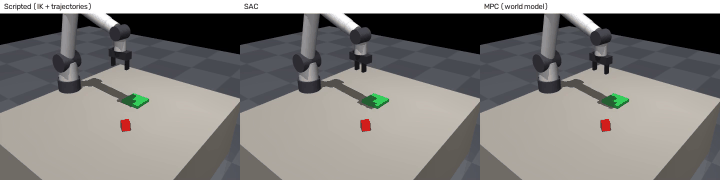
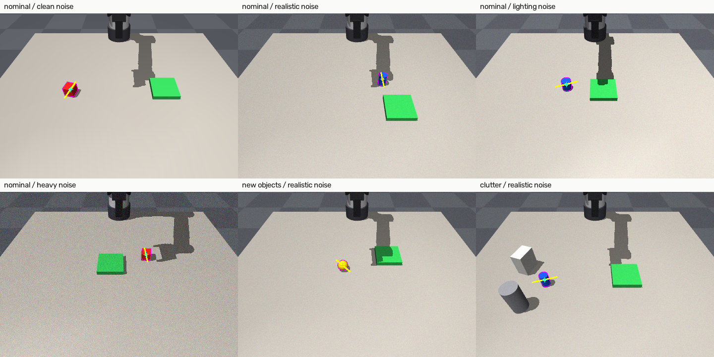
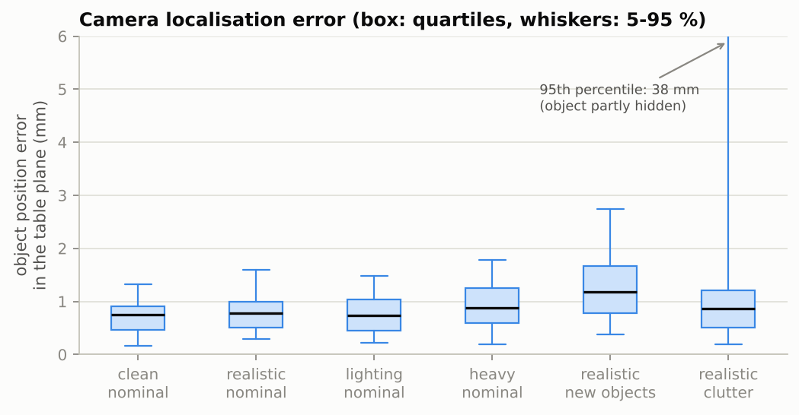
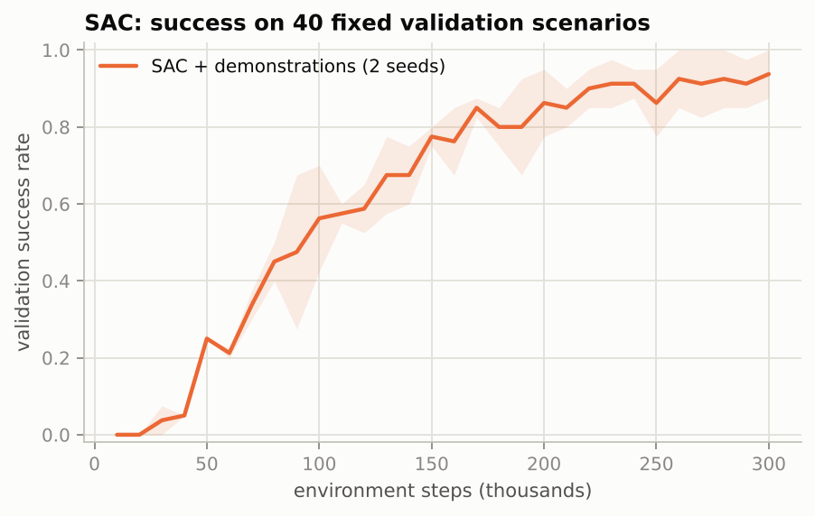
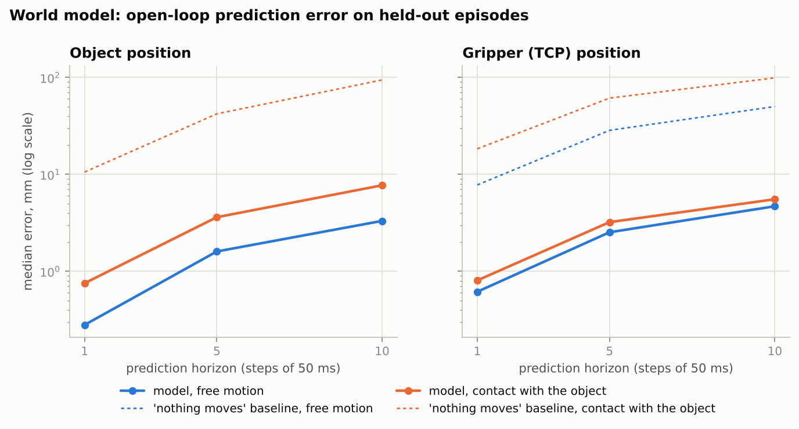
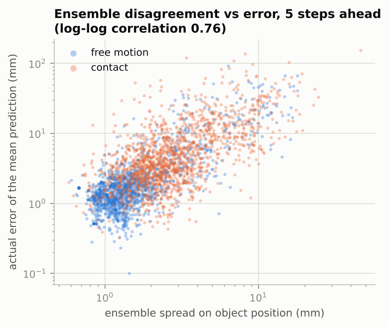
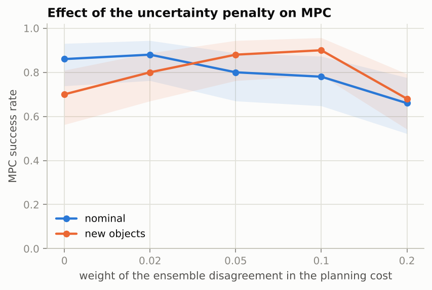
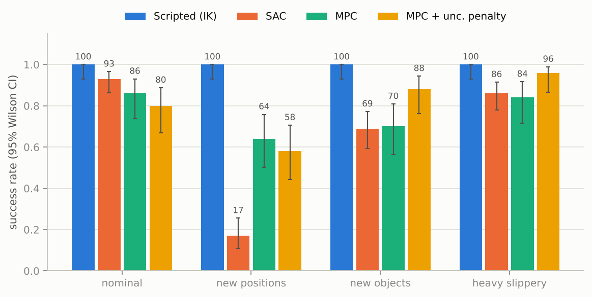
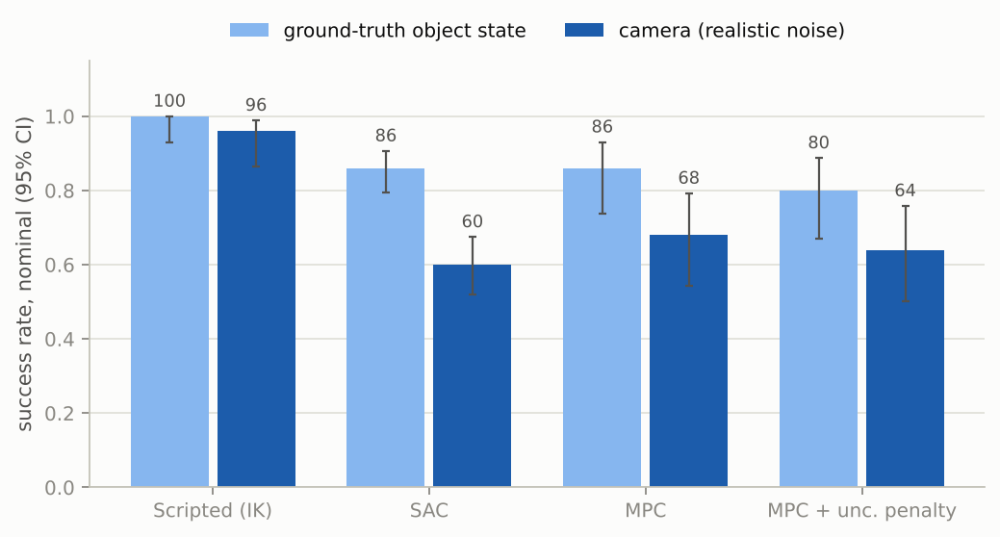

# Robotic pick-and-place with a learned world model

A simulated 6-DOF arm has to find an object on a table with an RGB-D camera, pick it up and put it down on a
target platform. Positions, object shapes, sizes, masses and frictions change from one episode to the next.
Three controllers solve the same task through the same interface and are compared on the same test episodes:

| | how it decides | what it needs |
|---|---|---|
| **Scripted** | waypoints + minimum-jerk Cartesian trajectories + inverse kinematics | a hand-written sequence of phases |
| **SAC** | neural policy trained by reinforcement learning (Stable-Baselines3) | 300k environment steps + 100 scripted demonstrations |
| **MPC** | samples action sequences, rolls them out in a learned dynamics model, executes the first action, replans | ~120k recorded transitions |

Everything runs in MuJoCo on two CPU cores; no robot, no GPU.



**In short** (success rate over the same 50 test episodes per condition, ground-truth object state; SAC pooled over 3 seeds):

| | nominal | new positions | new objects | heavier, slippery |
|---|---|---|---|---|
| Scripted (IK) | 100 % | 100 % | 100 % | 100 % |
| SAC | 86 % | 16 % | 69 % | 83 % |
| MPC | 86 % | 64 % | 70 % | 84 % |
| MPC + uncertainty penalty | 80 % | 58 % | 88 % | 96 % |

- The hand-written controller is the reference: it never fails here, but it is also the slowest
  (60 steps to success against 34 for SAC and 40 for MPC) and it encodes the whole task by hand.
- SAC and MPC are equal on the training distribution. Out of it, they fail differently: the SAC policy
  does not extrapolate to object and target positions it has not seen (16 %), while the learned dynamics
  carry over (64 %).
- Penalising the disagreement of the ensemble costs a few points where the model is right and gains 12 to 18
  points where the dynamics are new (unseen objects, heavier and slippery ones).
- The camera pipeline localises objects to about 1 mm. In the loop, the scripted controller barely notices
  (96 %), the learned controllers lose 18 to 26 points: they act on the full state, including quantities the
  camera measures badly (velocities) or only up to a symmetry (the yaw of a cube). Getting there took three
  fixes to the state estimator that ground truth had hidden.

## Contents

1. [Simulation](#simulation)
2. [Kinematics and scripted control](#kinematics-and-scripted-control)
3. [Perception](#perception)
4. [Reinforcement learning](#reinforcement-learning)
5. [World model](#world-model)
6. [Model predictive control](#model-predictive-control)
7. [Benchmark](#benchmark)
8. [What went wrong along the way](#what-went-wrong-along-the-way)
9. [Reproducing](#reproducing)

## Simulation

`assets/` holds the MJCF model, written from scratch:

- **Arm**: anthropomorphic 6-DOF arm with a spherical wrist (shoulder 0.20 m above the mounting plate, upper
  arm 0.40 m, elbow to wrist centre 0.38 m, wrist centre to TCP 0.17 m), 9 kg in total, joint limits,
  armature and damping. Each joint is driven by a position servo (`general` actuator with PD bias); gravity
  is compensated (`gravcomp`), as a real controller would do.
- **Gripper**: two sliding fingers coupled by an equality constraint, one force-limited position servo on
  the tendon averaging both fingers, high-friction pads with torsional friction.
- **Objects**: box, cylinder and sphere bodies with free joints. Only one is on the table in an episode;
  its size, mass, inertia and friction are rewritten in the compiled model at reset (`simulation/scene.py`),
  the others are parked out of view.
- **Target**: a 12 x 12 x 2 cm platform (mocap body). Being raised, it cannot be reached by pushing the object:
  the object has to be lifted.
- **Contacts**: elliptic friction cones with `impratio=10` (less slip in grasps), collision bitmasks so the
  arm links never collide with each other but do with the table, the platform and the objects.

A `Scenario` (object type, size, mass, friction, poses, platform position) fully defines an episode; it is
sampled from the ranges in `configs/simulation.yaml`, serialised to JSON, and the test sets in
`results/test_sets/` are plain lists of scenarios. `PickPlaceScene.save_snapshot/load_snapshot` stores the
scenario and the complete simulator state, and the tests check that a restored snapshot replays bit for bit.

Control runs at 20 Hz (25 physics steps of 2 ms). The action is
`(dx, dy, dz, dyaw, grip)` in [-1, 1]: a TCP displacement of up to 2.5 cm, a rotation of the finger axis of
up to 0.15 rad and an absolute gripper opening. The tool always points down. The low-level controller turns
the commanded TCP pose into joint targets with a few damped-least-squares iterations and clamps the TCP to
a workspace box that keeps the fingertips above the table.

## Kinematics and scripted control

`robotics/kinematics.py` is written from the MJCF chain directly (no DH table):

- **forward kinematics** and the **geometric Jacobian**, both checked against MuJoCo (`mj_kinematics`,
  `mj_jacSite`) on random configurations: max error 1e-15;
- **closed-form inverse kinematics** by kinematic decoupling: the wrist centre fixes q1..q3 (two-link planar
  problem), the remaining rotation R36 = R03ᵀR is an X-Y-X Euler triplet for q4..q6. All up to 8 branches
  are returned; the one closest to the current configuration is kept;
- **damped least squares** IK (used every control step), robust near the wrist singularity (q5 = 0).

The scripted controller (`robotics/controllers.py`) chains approach → descend → close → lift → transport →
lower → release → retreat. Each phase is a straight Cartesian segment with a minimum-jerk time law; the
action is the displacement to the next reference point. The gripper is pre-shaped to the object width plus
3.5 cm, the grasp axis is aligned with the narrow side of boxes, and a grasp that closes on nothing (or an
object that slips out) sends the controller back to the approach phase.

## Perception

A fixed RGB-D camera looks at the table from the front at 46°. `perception/` turns one frame into the object
pose and the target position:

1. back-project the depth map (intrinsics from `fovy`, extrinsics from MuJoCo's camera frame converted to
   the OpenCV convention) and keep points inside the workspace volume, more than 4 mm above the table;
2. segment in HSV: saturated pixels are the object, green ones the platform (the robot, the table and the
   distractors are grey); largest connected component;
3. **height** from the top face (points within 6 mm of the highest one), **centre and yaw** from the
   minimum-area rectangle of the top face, **width** from the footprint of the upper half of the object, which
   also works for spheres and leaves out the silhouette pixels that took the depth of the table behind them.

Sensor imperfections for the robustness tests: depth noise growing with z² (structured-light sensor),
missing depth pixels, RGB noise, random light intensities and directions, and two grey distractors that
occlude the object. A 5x5 median filter is applied to the depth map.

For closed-loop control, `CameraStateEstimator` replaces the object part of the state with camera estimates
at every step (joint angles still come from the encoders). While the object is held it is hidden by the
fingers, so it is assumed to move rigidly with the TCP until the gripper opens; partial views are rejected.

### Results



*Segmented region (magenta outline), estimated centre and grasp axis (yellow), ground truth (cyan cross).*

Single frames, 100 test scenes per line (`scripts/evaluate_perception.py`):

| condition | noise | detected | xy error median / p95 (mm) | yaw error median / p95 (deg) | target error (mm) |
|---|---|---|---|---|---|
| nominal | clean | 100 % | 0.8 / 1.3 | 0.0 / 0.4 | 1.0 |
| nominal | realistic | 100 % | 0.8 / 1.6 | 1.1 / 2.8 | 0.9 |
| nominal | lighting | 100 % | 0.7 / 1.5 | 0.6 / 2.2 | 0.9 |
| nominal | heavy | 100 % | 0.9 / 1.8 | 1.6 / 5.7 | 0.7 |
| new objects | realistic | 100 % | 1.2 / 2.7 | 0.8 / 2.7 | 0.8 |
| clutter | realistic | 99 % | 0.9 / 37.7 | 0.8 / 14.0 | 1.0 |



Noise and lighting barely matter thanks to the median filter and to measuring the centre on the top face
only. Occlusion does: with two distractors next to the object, one frame in twenty is off by several
centimetres because part of the object is hidden. Spheres (new objects) are measured from their visible
hemisphere only, which biases the width.

In the loop, with the scripted controller (30 test episodes each):

| object pose from | ground truth | camera, clean | realistic noise | + lighting changes | heavy noise | realistic, clutter |
|---|---|---|---|---|---|---|
| success | 100 % | 93 % | 97 % | 100 % | 100 % | 83 % |
| placement error (mm, median) | 1.8 | 3.7 | 3.0 | 3.4 | 3.7 | 4.5 |

With the camera, objects end up 2 mm further from the platform centre; the failures come from occlusion, and
in clutter the arm also hits the distractors, which no controller here knows about (they are not part of the
state).

## Reinforcement learning

`environments/pick_place_env.py` is a Gymnasium environment (it passes `gymnasium.utils.env_checker`):

- **observation** (44): the 33-dim state below, the task (target position, object half height and half
  width) and two difference vectors (object - TCP, target - object);
- **reward**: a function of the state only (`environments/reward.py`), so that the planner can evaluate it on
  predicted states. Before the object is on the platform it rewards reaching, closing the fingers on the
  object, holding it above the table, carrying it towards the target and lowering it; once it is on the
  platform it rewards centring, opening the gripper and moving the gripper away;
- **termination**: object off the table; episodes are truncated at 120 steps (6 s).

SAC (Stable-Baselines3, 2 x 256 networks, γ = 0.98, automatic entropy) is trained on the low-dimensional
observation, not on pixels: on two CPU cores, learning a pixel policy from scratch was out of budget, and
the camera is used at test time through the state estimator instead. Pure SAC never discovered how to grasp
in my runs, so 100 episodes of the scripted controller (with action noise) are kept in a separate buffer
and make up half of every batch, as in RLPD (Ball et al., 2023). Validation runs on 40 fixed scenarios
every 10k steps; training can be resumed from snapshots of the weights and the replay buffer.

### Results



- With demonstrations, the three seeds reach 85 to 100 % on the validation scenarios after 300k steps
  (about 2.3 h each on one shared CPU core). Without them, SAC did not complete a single one of its 2,465
  training episodes: it learns to reach the object but never discovers that closing the fingers and lifting
  pays off.
- On the test sets, the policy kept for each seed (best validation checkpoint) gives 94, 92 and 72 % on
  nominal scenarios. The spread between seeds is as large as the confidence interval of a single seed, which
  is why the tables pool three seeds.
- SAC is the fastest controller (34 steps to success on average, 0.5 ms per decision) but places less
  precisely (9 mm median from the platform centre, against 2 mm for the scripted controller): it optimises
  the reward, whose placement term tolerates 4 cm.

## World model

The model learns the transition `s_{t+1} = f(s_t, a_t)` on a 33-dim state:

| field | dim | |
|---|---|---|
| TCP position, finger axis yaw | 4 | yaw is kept in [-π/2, π/2] by the controller, no wrap-around |
| gripper opening and its velocity | 2 | |
| object position | 3 | |
| object orientation | 6 | first two columns of the rotation matrix (continuous, no double cover) |
| object linear / angular velocity | 6 | world frame |
| joint angles and velocities | 12 | joint limits are inside (-π, π) |

- **Architecture**: ensemble of 5 MLPs (3 x 200, SiLU) evaluated in one batched matmul; inputs are
  (s, a, object size) normalised; the output is the normalised state change Δs plus the logit of an
  unwanted contact during the step. Predicted rotations are re-orthonormalised (Gram-Schmidt).
- **Loss**: MSE on Δs (+ 0.1 x BCE on the contact flag); every member is trained on its own bootstrap sample;
  early stopping on a validation split.
- **Data**: ~120k transitions from the scripted controller (clean, noisy, with bursts of random actions),
  random actions, SAC checkpoints and MPC itself. **Train / validation / test are split by episode.**

### Results

Median open-loop error on the test episodes (the model is rolled out with the recorded actions, without
ever seeing the true state again). "Contact" windows are those where a finger touches the object.

| quantity | phase | 1 step | 5 steps | 10 steps (0.5 s) | "nothing moves", 10 steps |
|---|---|---|---|---|---|
| object position (mm) | free | 0.3 | 1.6 | 3.3 | 0.0 |
| object position (mm) | contact | 0.8 | 3.6 | 7.7 | 94.3 |
| TCP position (mm) | free | 0.6 | 2.5 | 4.7 | 50.2 |
| TCP position (mm) | contact | 0.8 | 3.2 | 5.5 | 99.1 |
| gripper opening (mm) | contact | 0.6 | 1.6 | 2.4 | 4.0 |
| object orientation (deg) | contact | 0.4 | 2.0 | 3.7 | 2.8 |



- Errors grow roughly linearly with the horizon and are twice as large when the fingers touch the object:
  that is where the dynamics are discontinuous (the object only follows the gripper once it is squeezed, and
  slips when the friction is low).
- Two things the model does worse than doing nothing: an object that nobody touches does not move, but
  the model predicts a few millimetres of drift after 10 steps; and objects mostly stay upright, so the
  constant guess of their orientation beats the model in contact phases. A structural prior (object
  dynamics gated by the distance to the fingers) would fix the first one.
- The ensemble knows when it is wrong: the disagreement between members and the actual error are
  correlated (0.76 in log scale, figure below). This is what the planner uses.



## Model predictive control

`planning/cem.py`, cross-entropy method in the loop:

1. sample 256 sequences of 10 actions (0.5 s) around the current mean;
2. roll every sequence through all 5 members;
3. score = discounted reward (the same function as for SAC) - predicted contact probability - λ x ensemble
   disagreement on the object and TCP positions;
4. refit mean and standard deviation on the 25 best, 3 iterations; execute the first action, shift the
   solution by one step to warm-start the next plan.

The reward is evaluated on the predicted states of all members, the contact head is turned into a
penalty, and the planning takes about 190 ms per decision on one CPU core, which is four times slower than
the 50 ms control period: in simulation this does not matter, on a robot it would mean a GPU, fewer samples
or a shorter horizon.

Two choices made the difference between a planner that works and one that does not (details in
[what went wrong](#what-went-wrong-along-the-way)): the time correlation of the sampling noise, and executing
the mean of the elites rather than the best sample, which picks the sequence whose prediction is luckiest
and so exploits the errors of the model.

### Uncertainty penalty



| condition | λ = 0 | λ = 0.02 | λ = 0.05 | λ = 0.1 | λ = 0.2 |
|---|---|---|---|---|---|
| nominal | 86 [74-93] | 88 [76-94] | 80 [67-89] | 78 [65-87] | 66 [52-78] |
| new objects | 70 [56-81] | 80 [67-89] | 88 [76-94] | 90 [79-96] | 68 [54-79] |

On the training distribution the penalty buys nothing: the model is right, avoiding the regions where the
members disagree only removes good options. On unseen objects (spheres, elongated boxes) it helps a lot up to
λ = 0.1, then the planner becomes too cautious everywhere. The same trend appears with heavier and slippery
objects (84 % → 96 % at λ = 0.05). λ = 0.05 is the value used in the benchmark.

## Benchmark

Same 50 scenarios per condition for every controller (`results/test_sets/`), success rate with 95 % Wilson
intervals. Success means the object rests on the platform, within 4 cm of its centre, released, at the end
of the 6 s episode. SAC is pooled over 3 seeds (150 episodes per condition).



| controller | nominal | new positions | new objects | heavy slippery |
|---|---|---|---|---|
| Scripted (IK) | 100 [93-100] | 100 [93-100] | 100 [93-100] | 100 [93-100] |
| SAC | 86 [80-91] | 16 [11-23] | 69 [61-76] | 83 [76-88] |
| MPC | 86 [74-93] | 64 [50-76] | 70 [56-81] | 84 [71-92] |
| MPC + uncertainty penalty | 80 [67-89] | 58 [44-71] | 88 [76-94] | 96 [87-99] |

Test conditions (`configs/simulation.yaml`): **new positions** puts the object up to 8 cm further from the
robot and to the sides than in training (x 0.62-0.70 m, |y| up to 0.30 m, against x 0.40-0.62, |y| < 0.22)
and the platform closer to the robot than ever in training (x 0.32-0.40 m); **new objects** are elongated
boxes and spheres, never seen in training; **heavy slippery** objects weigh 0.3-0.6 kg (0.05-0.3 in training)
with a friction coefficient of 0.3-0.5 (0.6-1.2 in training).

Nominal condition in detail:

| controller | success | placement error (mm, median) | steps to success | steps with a collision | decision time (ms) |
|---|---|---|---|---|---|
| Scripted (IK) | 100 % | 1.9 | 60 | 0.00 | 0.03 |
| SAC | 86 % | 9.1 | 34 | 0.31 | 0.5 |
| MPC | 86 % | 5.2 | 40 | 0.02 | 194 |
| MPC + uncertainty penalty | 80 % | 5.4 | 39 | 0.58 | 188 |

### With the camera in the loop

Same 50 nominal scenarios, object pose and task (target position, object size) estimated by
`CameraStateEstimator` from RGB-D frames with realistic noise, joint angles from the encoders:



| controller | ground truth | camera | placement error with camera (mm) |
|---|---|---|---|
| Scripted (IK) | 100 [93-100] | 96 [87-99] | 2.7 |
| SAC (3 seeds) | 86 [80-91] | 60 [52-67] | 15.4 |
| MPC | 86 [74-93] | 68 [54-79] | 18.3 |
| MPC + uncertainty penalty | 80 [67-89] | 64 [50-76] | 19.0 |

The scripted controller only needs the object position before the grasp and the platform position, which
the camera measures to a millimetre. SAC and MPC consume the whole state: velocities from finite differences,
an orientation that is only known up to the symmetry of the object, an object that is assumed to follow the
gripper while it is hidden in it. Neither was trained or fitted on such estimates; adding the estimator's
errors to their training data (or training on the estimated state directly) is the obvious next step.
The SAC seeds also react very differently (80, 50 and 50 %).

### When does the world model help?

- **Generalisation to new configurations.** The policy maps absolute positions to actions and collapses
  outside its training region (16 %), even though the dynamics there are the same. The dynamics model is
  queried on local changes (Δs) and keeps working (64 %).
- **New dynamics, with the uncertainty penalty.** When the objects or their physics are new, the ensemble
  disagrees on exactly the situations that go wrong, and steering away from them is worth 12 to 18 points.
- **It does not help on the training distribution**: SAC is as good, 400 times cheaper at run time and
  faster to complete the task. MPC also needs care that SAC does not: it optimises the reward *through* the
  model, so every loophole in the reward or the model gets used (it learned to throw objects onto the
  platform before "placed" was required to mean "at rest").
- **It is sensitive to the quality of the state**: see the camera-in-the-loop results above.

## What went wrong along the way

Kept here because most of the work was in these iterations.

- **Servo lag.** With the first PD gains the TCP covered only 55 % of the commanded displacement per step. The
  gains were doubled and the damping retuned on a step-response test (`scripted` episodes went from ~80 to ~58
  steps).
- **Rolling spheres.** After the gains change, every sphere rolled off the platform after release: MuJoCo has
  no rolling resistance with `condim=3`. The ball now has `condim=6` and rolling friction.
- **MPC scraping the platform.** The first reward kept rewarding the gripper for staying next to the object
  after placing it; MPC obeyed and its fingers rubbed the platform (all its "collisions"). The reward now
  switches to release-and-retreat once the object is down.
- **Flat reward far from the object.** `1 - tanh(10 d)` is flat beyond ~20 cm: pure SAC had nothing to follow.
  The scale was halved.
- **SAC never learned to grasp.** 20 of 30 validation episodes ended without the object being lifted. A small
  state-based grasp term (TCP on the object centre, fingers closed to its width) took SAC from 23 % to about
  90 % validation success with the same budget. Without demonstrations it still never succeeds.
- **MPC hovering, take 1.** With a 10-step horizon, holding the object 16 cm above the platform and putting it
  down looked the same to the planner until the last centimetre. A term rewarding the descent over the target
  fixed it; a bigger action penalty in the planner (tried against the arm wandering after placement) made
  things worse and was reverted.
- **MPC throwing objects.** "On target" only checked the position, so MPC learned to open the gripper while
  carrying the object fast over the platform: the condition was met for a step, then the cylinder landed with
  horizontal speed, tipped over and rolled away. "On target" now requires the object to be at rest.
- **MPC hovering, take 2: the optimiser, not the model.** It then held objects 1-3 cm above the platform.
  Rolling the model out by hand from such a state showed that it predicted correctly that putting the object
  down was better; but CEM with white noise almost never samples "go down, then hold still". Time-correlated
  sampling noise and keeping a fraction of the elites (iCEM) fixed 2 of the 4 remaining failures on those
  scenarios; executing the best sample instead of the elite mean broke 3 others.
- **Fingers scraping the platform with the camera in the loop.** A third of the camera-driven episodes had
  collisions. As the gripper descended over the object, its fingers partly hid it, the median-filtered depth
  mixed both surfaces at their edge and the estimate jumped by 15 mm; that error was then frozen into the
  in-hand offset. Camera updates are now skipped while the open gripper is around the object.
- **Phantom grasps.** With MPC (which sometimes pushes the object instead of grasping it), the estimator took
  a gripper closing on nothing for a grasp: on its way to fully closed, the finger gap went through the object
  width. MPC then carried an object that was not there. A grasp now requires the fingers to have stopped at the
  object width.
- **SAC blind with the camera (10 % instead of 90 %).** Replacing the estimate by ground truth piece by
  piece pointed at the task vector and the orientation, not at the position error. The platform height is
  the same in every training episode, so its variance in SAC's running normaliser was ~0 and a 1 mm
  measurement error became a 10-sigma input. A 1 mm floor on the
  normalisation (no effect on anything that varied in training) and reporting the yaw of symmetric objects in
  the simulator's convention brought it back to 60 %.
- **Data collection killed by the job time limit.** The first on-policy MPC run oversubscribed the two CPU
  cores (two torch threads next to two SAC trainings), printed nothing and only saved at the end: after two
  hours it was stopped with nothing written. Data collection now uses one thread, logs progress and saves every
  10 episodes (20 minutes for the same run).
- **A too-small test.** One round of MPC data aggregation looked like it took MPC from 16/20 to 20/20; on the
  50 test scenarios the difference vanished (78 % vs 76 %), and the reward had changed in between. Hence the
  fixed test sets and confidence intervals everywhere.
- **Background jobs limited to two hours.** Runs are therefore resumable (SAC snapshots with the replay buffer,
  evaluation scripts that skip what is already in their CSV file).

## Reproducing

```bash
pip install -e ".[dev]"                # Python >= 3.10: MuJoCo, PyTorch, SB3, OpenCV
pytest                                 # 35 tests: kinematics vs MuJoCo, env API, perception, world model

# the tables from the shipped checkpoints, no training needed (~2 h on one core, mostly MPC)
python scripts/evaluate.py --world-model results/world_model/ensemble.pt \
    --sac-runs results/checkpoints/sac_demo_s0 results/checkpoints/sac_demo_s1 results/checkpoints/sac_demo_s2
python scripts/evaluate.py --observation camera --noise realistic --conditions nominal --sac-runs ...
python scripts/evaluate_perception.py
python scripts/uncertainty_sweep.py
python scripts/make_figures.py && python scripts/make_tables.py
python scripts/record_video.py --sac-run results/checkpoints/sac_demo_s0

# everything from scratch
python scripts/collect_data.py scripted && python scripts/collect_data.py random
python scripts/train_rl.py --seed 0 --demo-episodes 100 --name sac_demo     # ~2.3 h, resumable with --resume
python scripts/collect_data.py sac --run runs/sac/sac_demo_s0
python scripts/train_world_model.py --data data/scripted.npz data/random.npz data/sac.npz --out runs/world_model_v1
python scripts/collect_data.py mpc --model runs/world_model_v1/ensemble.pt --episodes 100 --out data/mpc_round1.npz
python scripts/train_world_model.py --data data/*.npz                       # -> results/world_model/
```

On a Linux machine without a display, rendering needs `MUJOCO_GL=egl` (and `LP_NUM_THREADS=1` keeps Mesa's
software renderer from competing with other jobs for the cores); on macOS the default backend works.

Seeds: validation scenarios use seed 1000, test sets seed 2024 (+100 per condition) and are stored in
`results/test_sets/`. Configurations are in `configs/`, and every SAC run copies the configs it used.
Checkpoints used for the tables: `results/world_model/ensemble.pt` and `results/checkpoints/`.

## Repository layout

```
configs/            simulation, vision, rl, world_model, planning
assets/             MJCF: robot/, objects/, scenes/
src/rwm/
  simulation/       scene wrapper, scenario sampling, snapshots
  robotics/         kinematics (FK, Jacobian, closed-form and DLS IK), controllers
  perception/       camera model, segmentation and pose, noise, state estimator
  environments/     Gymnasium env, state layout, reward
  rl/               SAC setup, demo buffer, logging, resumable training
  world_model/      transition dataset, ensemble, training, multi-step evaluation
  planning/         CEM model predictive control
  evaluation/       rollouts, benchmark statistics, perception metrics, plots
scripts/            entry points (collect, train, evaluate, figures, video)
tests/              pytest
results/            CSV results, figures, video, test sets, checkpoints
notebooks/          analysis of the result files
```
